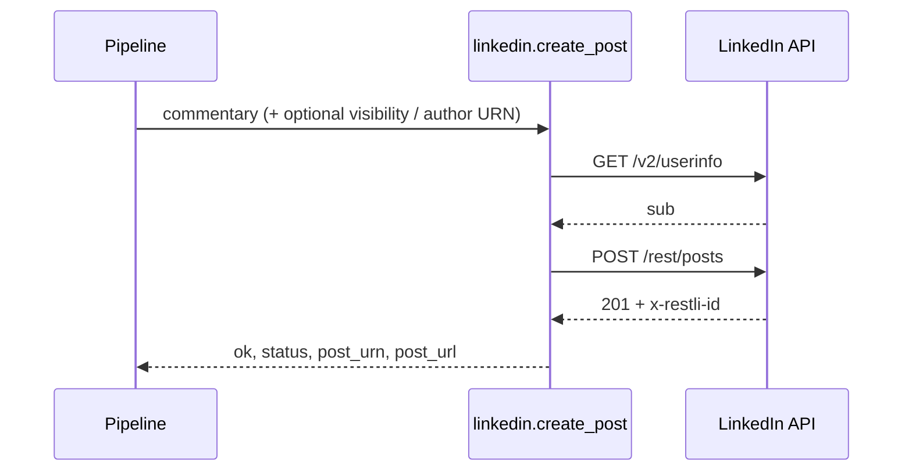

# LinkedIn connector for Tamtree

Publish a **text post** to the authenticated member’s LinkedIn feed from a [Tamtree](https://www.tamtree.io) workflow, and get a **structured status** back — post URN, URL, HTTP status — not a silent 201.

This is a **community plugin** in its own git repo. Tamtree never vendors the source. At boot it discovers two Python entry points, the same way it loads Slack and Gmail from `tamtree-nodes`.

| | |
|---|---|
| **Palette** | LinkedIn — Create post |
| **Node type** | `linkedin.create_post` |
| **Credential** | LinkedIn (`linkedin_api`, OAuth2) |
| **Plugin / allowlist** | `linkedin-connector` |
| **Wheel** | `tamtree-linkedin-connector` |
| **Icon** | `tamtree_linkedin/icons/linkedin.svg` (thesvg.org `linkedin`, `manifest.icon`) |

v1 is **personal profile, text only** (`openid profile w_member_social` / Share on LinkedIn). Images, video, documents, and company pages are later — company posting needs LinkedIn’s Community Management product and partner review.

---

## Why a code plugin

LinkedIn’s create-post success is **HTTP 201, empty body, post id in the `x-restli-id` header**. Tamtree’s declarative HTTP executor (`HttpOperationSpec`) reads the **body only** and drops headers. An empty JSON body becomes zero output items — no `ok`, no URN, no URL.

This node is a thin `ctx.http()` wrapper that:

1. Resolves `urn:li:person:{sub}` from OpenID `GET /v2/userinfo` (skipped if you set **Author URN**).
2. `POST https://api.linkedin.com/rest/posts` with `Linkedin-Version: 202607`.
3. Maps the Rest.li header onto a **declared** output schema so downstream nodes can map fields before a run.



---

## Node

**Credentials:** `linkedin_api` (required).

| Param | Type | Required | Default | Notes |
|---|---|---|---|---|
| `commentary` | string | yes | — | Post body. Map from an upstream item with `{{ }}`. |
| `visibility` | options | no | `PUBLIC` | `PUBLIC` or `CONNECTIONS`. |
| `author_urn` | string | no | *(userinfo)* | `urn:li:person:…` or a bare member id. Blank → OpenID `sub`. |

One output item per input item (or a single item if the port is empty). Userinfo is resolved **once per execute** and reused across the batch.

### Output (`main`)

```json
{
  "ok": true,
  "status": 201,
  "post_urn": "urn:li:share:6844785523593134080",
  "post_url": "https://www.linkedin.com/feed/update/urn:li:share:6844785523593134080",
  "lifecycle_state": "PUBLISHED",
  "error_code": null,
  "error_message": null,
  "body": {}
}
```

| HTTP | What the node does |
|---|---|
| `2xx` | `ok: true`, URN from `x-restli-id` |
| `4xx` except `429` | `NodeConfigurationError` — non-retryable (reconnect, scopes, bad text) |
| `429` / `5xx` | plain `RuntimeError` — engine retries |

The access token is never written onto the item.

**Rate limit:** Share on LinkedIn is on the order of **150 requests / member / day**. Budget userinfo + create as two calls when Author URN is blank.

---

## LinkedIn developer app

1. Create an app at the [LinkedIn Developer Portal](https://www.linkedin.com/developers/apps).
2. Add products:
   - **Sign In with LinkedIn using OpenID Connect** — `openid profile`
   - **Share on LinkedIn** — `w_member_social` (personal posting; no partner wait)
3. Auth tab → **Authorized redirect URLs** — exact match, HTTPS, no wildcards:

| Tamtree | Register this one URL |
|---|---|
| Contracts **1.28+** (what this plugin requires) | `https://<your-tamtree-host>/api/oauth/callback` |
| Older instances (callback still includes the credential UUID) | `https://<your-tamtree-host>/api/oauth/callback/<credential-id>` — only after the credential row exists |

LinkedIn rejects a mismatch. There is no wildcard, and a new credential is a new UUID, which is why the stable callback is required for a usable connect flow. The per-credential path still exists as an alias, so a flow authorized before an upgrade can finish — but register only the stable one.

Client ID and Client secret go into the Tamtree credential. Everything else is filled in for you — the first three rows are `default=` on the field spec, applied server-side on create when you leave the box blank:

| Field | Value | |
|---|---|---|
| Authorize | `https://www.linkedin.com/oauth/v2/authorization` | default |
| Token | `https://www.linkedin.com/oauth/v2/accessToken` | default |
| Scopes | `openid profile w_member_social` | default |
| Userinfo (optional probe) | `https://api.linkedin.com/v2/userinfo` | paste to opt in |

A default is never applied on **update** and never over a value you supplied, so an emptied field stays empty. The userinfo probe is deliberately not defaulted — filling it in would start a userinfo call on every credential.

Access tokens last **~60 days**. Tamtree refreshes when `refresh_token` and `token_url` are present.

---

## Install

### Local Tamtree checkout

```sh
cd ~/sites/tamtree
uv pip install -e ~/sites/tamtree-plugins/linkedin-connector
# restart API + engine workers
```

Live-dev (dev-only — a production boot **refuses** this env var):

```sh
mkdir -p ~/tamtree-plugins
ln -s ~/sites/tamtree-plugins/linkedin-connector ~/tamtree-plugins/linkedin-connector

# terminal 1
TAMTREE_DEV_PLUGINS_DIR=$HOME/tamtree-plugins make dev

# terminal 2
TAMTREE_DEV_PLUGINS_DIR=$HOME/tamtree-plugins make worker
```

Allowlist — optional on a laptop; **required** if the variable is set at all. An allowlist that omits this plugin **refuses the entire boot**.

```sh
TAMTREE_PLUGINS_ALLOWED=linkedin-connector
```

Empty allowlist = every installed plugin loads.

### Production image

This repo ships a `Dockerfile` that layers the wheel onto the official Tamtree image:

```dockerfile
ARG TAMTREE_VERSION=0.1.0
FROM ghcr.io/tamtree/tamtree:${TAMTREE_VERSION}
# … uv pip install this directory
```

```sh
docker build --build-arg TAMTREE_VERSION=0.1.0 -t tamtree:linkedin .
```

Pin `tamtree-linkedin-connector==0.2.0` in the instance plugin-set, bake, recycle workers (`make plugins-recycle` / Helm roll). Writing `POST /api/admin/plugin-set` installs **nothing by itself** — code arrives only in the next image.

---

## Connect and run a flow

1. **Credentials** → add **LinkedIn**. Client ID + Client secret; leave the URLs and scopes blank and the defaults fill them in.
2. **Save & connect** — redirects to LinkedIn and comes back **Connected**.
3. Canvas: **LinkedIn — Create post**. Bind the credential. Map upstream text into **Post text**.
4. Run. Downstream: branch on `ok` / `status`, or pass `post_url` to a notification node.

### Enable / disable

| Layer | What it does | Restart? |
|---|---|---|
| **Extensions** page switch | Per-workspace. Palette hides the node; in-flight steps fail non-retryably. Code stays loaded. | No |
| `TAMTREE_PLUGINS_ALLOWED` | Instance-wide boot allowlist. Omit + recycle to hide without rebuilding. | Recycle workers |
| Drop the wheel | Real uninstall. | Rebuild image |

Re-enable is the same switch. Disable does **not** `sys.modules.pop`.

---

## OAuth: requires contracts 1.28

The node binds type **`linkedin_api`** with `auth_kind="oauth2"`. Tamtree’s OAuth machinery used to be keyed on the **type name** `"oauth2"`, which no named type can ever match. That is fixed as of contracts **1.28.0** (Tamtree PR #6), and `tamtree-plugin.toml` pins `sdk = "^1.28"` accordingly — an older instance **refuses this plugin at boot** (§20.3) rather than installing it into a connect flow that cannot complete.

What 1.28 brought, all three of it additive:

1. OAuth keyed on `auth_kind` via `merged_credential_types(registry)` — unblocks `linkedin_api` **and** the built-in `google_api` (Gmail, Sheets), which had the same gap.
2. One stable callback per instance, `{public_url}/api/oauth/callback`; the credential is recovered from the in-flight `state`. The per-credential path stays as an alias and still exchanges against **that** URI, so a flow authorized before the upgrade can finish.
3. `CredentialFieldSpec.default`, applied on create only — what fills in the URLs and scopes above.

On an instance older than 1.28 the boot refusal is the whole story; there is no degraded mode to describe. This node also **cannot** fall back to the generic OAuth2 type: `ctx.credential("linkedin_api")` only sees a credential bound as LinkedIn.

One thing CI cannot cover: the exchange against LinkedIn's real IdP. Register exactly one redirect URL — `https://<host>/api/oauth/callback` — and smoke it.

---

## Develop

This `pyproject.toml` path-depends on a Tamtree checkout at `../../tamtree` (`tamtree-plugin-sdk` + `tamtree-sdk`). The Tamtree source is not public yet, so for now building and testing needs access to it. Without that tree, once the SDK is published:

```sh
uv add 'tamtree-plugin-sdk[testing] @ git+https://github.com/tamtree/tamtree@main#subdirectory=packages/plugin-sdk'
```

```sh
uv sync --extra testing --extra dev
uv run pytest          # no network, no LinkedIn
uv run ruff check .
uv run ruff format --check .
uv run mypy
```

Imports: `tamtree_plugin_sdk` only, except `NodeConfigurationError` (not yet re-exported by the facade — `from tamtree_sdk import NodeConfigurationError`). **Never** `tamtree_server` or `tamtree_nodes`.

Manual smoke (still owed): LinkedIn app → connect → one-node flow with a throwaway post.

---

## Icon

The node declares `icon="icons/linkedin.svg"` — a package-relative path from `tamtree_linkedin/`, the same convention as `tamtree-plugin.toml`. The file is the official LinkedIn logomark from [thesvg.org](https://thesvg.org), vendored with the same CLI Tamtree uses for Slack/Gmail/GitHub:

```sh
npx @thesvg/cli add linkedin --format svg --variant default --dir tamtree_linkedin/icons
```

Square `viewBox="0 0 256 256"`, 768 bytes, LinkedIn blue `#0A66C2`. Wordmark variant is not used (too wide for the 60px tile).

Until Tamtree serves plugin icons (`GET /api/extensions/{family}/{name}/icon` and `NodeIcon` reading `manifest.icon`), the palette still falls through to the Connectors `Globe`. Shipping the SVG now means that platform work picks it up with no plugin change.

---

## Out of scope (v1)

- Images / video / documents (Images API register-upload, then Posts API `content.media`)
- Company pages (`w_organization_social`, organization URN, partner approval)
- Polling trigger (“new mentions”) — `r_member_social` is restricted
- First-party `BRAND_ICON_TYPE` entry in Tamtree’s frontend (plugin-declared SVG instead)
- Tamtree Cloud in-process install (SEC-G1: code plugins are image-bake only)

---

## License

Apache-2.0
